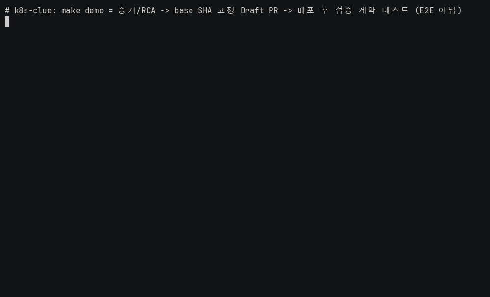

# K8s Clue

Kubernetes 장애 증거를 읽기 전용으로 수집하고, 규칙으로 원인을 판정한 뒤 허용된 변경만 GitHub Draft PR로 제안합니다.

클러스터를 직접 변경하거나 PR을 자동 병합하지 않습니다. 예를 들어 ImagePullBackOff 증거에서 잘못된 이미지 태그를 판별하면, 승인된 manifest의 image 값만 바꾸는 수정안을 구성합니다. 증거가 부족하거나 승인된 변경 대상에 충돌이 생기면 PR 생성을 중단합니다.

[](https://github.com/woonyong-choi/k8sSeam/actions/workflows/ci.yml)



이 GIF는 `DEMO_SKIP_PR=1 DEMO_KIND_CONTEXT=kind-clue-demo bash scripts/demo_terminal.sh`의 실행 기록입니다. kind의 실제 장애 증거를 뒤의 계약 테스트 입력으로 넘기는 데모는 아니며, GitHub에 실제 PR도 발행하지 않습니다.

> [!NOTE]
> 개발 중입니다. 배포판은 없고 소스를 직접 실행합니다.

## 빠른 시작

Python 3.13과 [uv](https://docs.astral.sh/uv/getting-started/installation/)가 필요합니다. 아래는 클러스터나 GitHub를 변경하지 않고 대표 경로의 계약 테스트를 실행하는 방법입니다. 제품 전체를 설치하고 외부 연동까지 확인하는 절차는 아닙니다.

```sh
git clone https://github.com/woonyong-choi/k8sSeam.git
cd k8sSeam
uv sync --all-groups
DEMO_KIND_CONTEXT= DEMO_SKIP_PR=1 make demo
```

입력은 테스트에 정의된 ImagePullBackOff 증거와 GitHub 응답입니다. 실행 결과는 원인 판정, base SHA를 고정한 Draft PR, 배포 후 증거 검증, 안전 계약을 나누어 검사한 pytest 결과입니다. 2026-10-21에 위 계약 검사 명령을 다시 실행해 각각 24개, 29개, 27개, 6개로 총 86개 통과를 확인했습니다. 출력 일부는 아래와 같습니다.

```text
[demo][skip] kind scene (DEMO_KIND_CONTEXT unset)
[demo] ImagePullBackOff evidence and deterministic RCA
24 passed in 2.15s
[demo] base-SHA-pinned GitOps Draft PR (contract only, no live PR)
29 passed in 0.56s
```

실제 클러스터 재현과 계약 검사는 별개이므로 테스트 통과를 실제 장애 복구 완료로 해석하면 안 됩니다. 위 실행 시간은 개별 테스트 실행 기록이며 제품의 장애 처리 성능 측정값은 아닙니다.

`DEMO_KIND_CONTEXT`에 값을 주면 해당 클러스터에서 namespace와 Deployment를 생성·삭제합니다. 계약 검사만 하려면 위처럼 빈 값으로 실행하세요. `DEMO_SKIP_PR=0`은 실제 PR 생성 경로가 구현되지 않아 실행 전에 오류로 종료합니다. 전체 명령은 `make help`, 필요한 도구는 `make doctor`로 확인할 수 있습니다.

## 해결하는 문제

장애 증거를 수집한 시점과 수정안을 검토하는 시점 사이에 Git 저장소가 바뀔 수 있습니다. K8s Clue는 증거와 대상 리소스를 연결하고, 원인 판정의 근거와 수정할 필드를 제한한 뒤, PR 생성 직전에 base SHA를 다시 확인합니다. 운영자는 이 근거와 변경 내용을 보고 병합 여부를 결정합니다.

`kubectl`로 Pod와 Event를 직접 확인하고 Git 변경안을 작성하는 방법도 가능합니다. K8s Clue는 그 과정에서 증거 참조, 규칙 버전, 허용 필드와 PR 생성 조건을 코드와 계약 테스트로 관리합니다. 임의의 장애를 해결하는 범용 도구는 아니며, 현재 재현과 계약 검사 기록이 있는 대표 시나리오는 ImagePullBackOff 하나입니다.

Argo CD 같은 GitOps 배포 도구를 대신하지도 않습니다. 이 저장소의 역할은 증거를 바탕으로 제한된 변경안을 제안하고 이후 관측 결과를 검증하는 것입니다. 실제 PR 생성부터 병합·배포·회복까지 연결한 종단 검증은 아직 끝나지 않았습니다.

## 작동 방식

1. `cluster-agent`가 Kubernetes API의 `get`·`list`·`watch` 권한으로 증거를 읽고 gateway에 전송합니다.
2. 규칙 엔진이 버전이 붙은 YAML 카탈로그로 원인 후보를 판정합니다. 규칙 밖의 증거는 실패 단계, reason code와 원문 참조를 남깁니다.
3. `safe-pr-worker`가 허용된 scalar 값만 바꿉니다. `scm-worker`는 base SHA를 재확인하고 `draft: true`인 PR만 허용합니다.
4. 사람이 병합·배포한 뒤에는 새 evidence window를 변경 전 기준선과 비교합니다. 검증 시작 시각보다 오래된 증거는 거부합니다.


YAML 전체를 다시 출력하지 않고 대상 `ScalarNode`의 byte span만 치환합니다. [속성 테스트](tests/test_source_patch_splice_properties.py)는 한 줄 변경, 주석 수 보존과 rollback의 byte 단위 원문 복원을 검사합니다. Helm 권한 검사는 차트 원문이 아니라 렌더링 결과를 대상으로 하며, 변경 권한·exec·attach·proxy·wildcard를 거부합니다.

현재 Controller는 제어면 서비스 11개를 한 프로세스로 조합합니다. 별도 대상 에이전트를 포함하면 서비스 항목은 12개이며 Pod 수를 뜻하지는 않습니다. 구성과 사건 이력 API는 [Project Map](docs/PROJECT-MAP.md), 변경 제한과 검증 조건은 [설계 근거](docs/design.md)와 [Golden Path](docs/GOLDEN-PATH.md)에 있습니다.

## 상태

규칙 기반 진단, 제한된 패치, Draft PR과 회복 검증의 계약 테스트가 있습니다. 사건 목록·상세 화면과 보존된 사건 이력 조회도 구현되어 있습니다. 이력은 관측하지 못한 삭제 시각을 정확한 시각으로 표시하지 않으며 수집 범위의 불완전성을 함께 반환합니다.

전체 pytest와 Frontend 검사는 2026-10-10 기록입니다. 전용 PostgreSQL 17.11에서 302개가 경고 없이 통과했고, DB 없이 실행하면 265개 통과와 37개 skip입니다. Frontend 응답 계약·경로 테스트 18개, typecheck, lint, build도 통과했습니다. 실제 Redis 8.10.2와 HTTP gateway에서 로그인, 조회, 세션 만료, Redis 장애 중 인증 거부와 재연결을 확인한 기록이 있습니다. 이후 추가된 사건 이력 기능까지 포함한 현재 전체 테스트 수를 뜻하지는 않습니다.

아래 표는 같은 명령으로 실행하는 네 계약 검사 묶음입니다. kind 재현과 RCA 합성 평가를 포함한 나머지 수치는 2026-09-23 기록이며 이번 문서 수정에서 새로 측정한 결과가 아닙니다.

| 계약 검사 | 확인 대상 | 기록된 통과 수 |
|---|---|---:|
| 증거·RCA | ImagePullBackOff 증거의 규칙 판정 | 24 |
| Draft PR | base SHA 고정, draft 강제, merge 경로 부재 | 29 |
| 배포 후 검증 | 기준선 대비 회복 판정, stale window 거부 | 27 |
| Golden Path 안전 계약 | read-only·correlation·멱등성·allowlist 등 9개 조항 | 6 |

속성 테스트 6개, 운영 데이터 카탈로그 검사 79개 통과 기록도 있습니다. Helm 검사에서는 렌더링한 Kubernetes object 11개에 mutation verb와 wildcard가 없었고, event bus의 in-process와 NATS 결과는 `equivalent: true`였습니다. `make test`는 lint, 컴파일 검사, `uv.lock`에서 내보낸 의존성과 `requirements.txt`의 일치 여부, pytest를 함께 확인합니다.

RCA 카탈로그는 29개 rule과 87개 candidate를 사용합니다. [합성 평가](evals/results.md)는 장애 87개와 정상 29개, 총 116개 시나리오에서 accuracy 87/87, 오탐 0/29, confusion pair 0을 기록했습니다. 카탈로그를 역산한 합성 입력이므로 accuracy 100%는 실제 장애 정확도가 아니라 후보가 다른 규칙에 가려지지 않는지 확인한 결과입니다.

실사용 트래픽, 복구 시간, 처리량과 비용은 측정하지 않았습니다. 외부 클러스터와 GitHub App을 연결한 종단 검증도 미완입니다. 지표·로그 임계치가 필요한 경로에는 패치 allowlist와 회복 검증의 제약이 남아 있습니다. `clue diagnose`는 계획된 CLI이며 현재 실행 진입점은 Make 타깃입니다.

인벤토리 전체의 삭제 처리와 사건 이력의 삭제 관측은 서로 다른 기능입니다. 현재 사건 이력은 완전성이 확인된 namespace의 Pod 수집에서 빠진 객체만 삭제로 인정합니다. 범위 제한 수집이므로 이력 전체 상태는 `partial`입니다. 세부 조건은 [Project Map](docs/PROJECT-MAP.md)에 있습니다.

후속 작업은 [GitOps 증거 연결 #22](https://github.com/woonyong-choi/k8sSeam/issues/22)에서 추적합니다. 저장·통신 호환 때문에 남아 있는 `kyro`·`KYRO` 식별자의 마이그레이션 경로는 아직 정하지 않았습니다. 안정된 명령·설정·데이터 형식의 호환성을 보장하는 단계는 아닙니다.

## 문서

- [시작](docs/PROJECT-MAP.md)
  - [제품 완성 계획](docs/PYTHON-FIRST-PLAN.md)
- [설계](docs/design.md)
  - [안전 계약](docs/GOLDEN-PATH.md)
  - [수집 완전성](docs/collection-contract.md)
  - [메타데이터 카탈로그](docs/metadata-catalog.md)
- [명세](docs/catalog-api.md)
  - [품질 검사 SQL](docs/sql-quality-checks.md)
- [기여 이력](docs/personal-extension.md)

[전체 문서](docs/README.md)

## 개발

DB 연동 검사에는 Docker로 실행하는 카탈로그 PostgreSQL이 필요합니다. 아래 DB 명령은 로컬 컨테이너와 테이블을 생성합니다.

```sh
make catalog-up
make catalog-schema
make test
make manifest-check
```

Frontend는 Node.js 22를 사용하며 CI에서 아래 명령으로 검사합니다.

```sh
cd frontend
npm ci --include=dev --no-audit --no-fund
npm run check
```

이 저장소는 크래프톤 정글 5인 팀 과제([원본](https://github.com/minmings111/Kyro-jungle-final))에서 시작한 개인 포크입니다. 팀장은 전체 아키텍처, 이벤트 런타임, 서비스 간 계약, CI와 배포를 맡았고, 팀원은 룰 카탈로그·에이전트 수집·PR 생성·게이트웨이 인증을 작성했습니다. 과제 종료 후 개인 작업의 커밋 경계는 [기여 이력](docs/personal-extension.md)에 있습니다. upstream [skyhook-io/radar](https://github.com/skyhook-io/radar)의 Apache-2.0 출처와 재작성 범위는 [NOTICE](NOTICE)에 있습니다. 루트 `LICENSE` 파일은 현재 없습니다.
